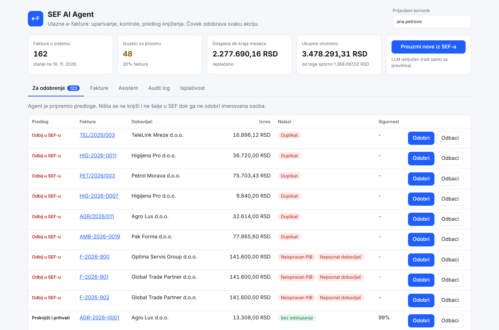
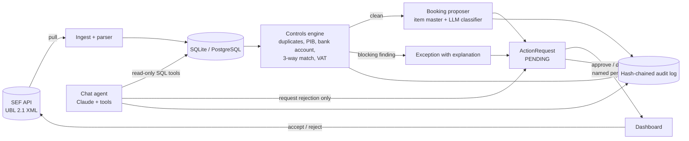

# SEF AI Agent: accounts payable automation for Serbian e-invoices

An AI agent that takes incoming e-invoices from **SEF (Sistem e-faktura)**, checks them against purchase orders and
goods receipts, catches duplicates and fraud patterns, proposes the journal entry, and answers questions in Serbian
such as *"Koliko dugujemo dobavljaču X do kraja meseca?"*. A person approves every action, and every step is written
to a tamper-evident audit log.



## Why this problem

Since 2023 every B2B invoice in Serbia arrives through SEF as UBL 2.1 XML. Every company therefore has the same
structured input and the same manual work: open the invoice, compare it with the order and the receipt, look for
duplicates, pick the account, enter it in the ledger, accept it in SEF, and later answer "how much do we owe".
That work is repetitive, error-prone and the place where duplicate payments and fake-supplier invoices slip through.

## What it does

| Step | How | Who decides |
|---|---|---|
| Pull new invoices from SEF | `SefClient` (public API with `ApiKey`, or a mock with the same interface) | system |
| Parse UBL 2.1 (SRBDT profile) | `sef/ubl.py`, XXE-safe parser | system |
| Duplicate checks | same number (normalised: `ABC-2026-0018` = `ABC/2026/18`), and same amount within 45 days | rules |
| Supplier checks | PIB check digit (ISO 7064 MOD 11,10), unknown supplier, **bank account differs from master data** | rules |
| 3-way match | invoice vs purchase order (price, item) vs goods receipt (quantity, net of earlier invoices) | rules |
| Arithmetic | VAT per rate and totals | rules |
| Booking proposal | account per line: item master, or LLM classification with structured output for free-text lines | LLM + rules |
| Questions in Serbian | tool-using agent; every number comes from SQL tools | LLM |
| Accept / reject in SEF, booking | `ActionRequest` waiting for a named person | **person** |
| Audit | SHA-256 hash chain over every event | system |

## Architecture



Design decisions and the reasons behind them are in [DECISIONS.md](DECISIONS.md).

## Results

Measured with `sef-agent eval` on 162 synthetic invoices (110 clean, the rest with injected problems). Full report:
[docs/eval_report.md](docs/eval_report.md).

| Metric | Result |
|---|---|
| Invoices routed correctly (to a person exactly when needed) | **98.8%** (2 false "possible duplicate" flags, 0 missed problems) |
| Recall on injected problems (duplicates, price, quantity, bank account, fake supplier, VAT) | **100%** |
| Booking accuracy, all lines, keyword baseline | 98.8% |
| Booking accuracy, hand-written hard set, keyword baseline | 43.6% |
| Booking accuracy and cost per line, LLM | run `sef-agent eval` with `ANTHROPIC_API_KEY` set |
| Q&A accuracy against SQL ground truth | run `sef-agent eval --qa` with `ANTHROPIC_API_KEY` set |
| Estimated saving at 400 invoices/month | ~51 hours and ~60.000 RSD per month (assumptions in `roi.py`) |

The detection numbers prove the controls work as specified. The same team wrote the data generator, so they are not
a real-world accuracy estimate; that needs a pilot on a company's own SEF data.

## Quick start

```bash
pip install -e ".[dev]"
sef-agent seed            # generate demo company, pull 162 invoices from the mock SEF, process them
sef-agent eval            # evaluation report -> docs/eval_report.md
cd web && npm install && npm run build && cd ..
sef-agent serve           # http://127.0.0.1:8000
```

With an Anthropic API key the booking classifier and the Serbian chat agent switch on:

```bash
export ANTHROPIC_API_KEY=...
sef-agent ask "Koliko dugujemo dobavljaču Agro Lux do kraja meseca?"
sef-agent eval --qa
```

Docker (app + PostgreSQL): `docker compose up --build`, then open http://localhost:8000.

Against the real SEF demo environment: set `SEF_MODE=http`, `SEF_BASE_URL=https://demoefaktura.mfin.gov.rs` and
`SEF_API_KEY` (generated in the SEF web app). Check the endpoint names in `sef/client.py` against the Swagger page
of your environment first.

## Project layout

```
sef_agent/
  sef/          UBL builder/parser, SEF clients (HTTP + mock), PIB and bank-account validators
  matching/     controls engine and severity table
  booking/      account classification (rules, LLM) and journal-entry proposal
  agent/        chat agent loop and read-only query tools
  domain/       chart of accounts excerpt, synthetic data generator
  eval/         evaluation runner and hand-written hard set
  api/          FastAPI app (REST + dashboard)
  pipeline.py   processing and the human approval step
  audit.py      hash-chained audit log
  roi.py        business-case calculator
web/            React + TypeScript dashboard (Vite)
tests/          20 tests, including the agent loop with a scripted fake model
```

## Limitations and next steps

- Demo authentication is a user name in a header; production needs SSO/OIDC and roles (who may approve what amount).
- Booking export to a specific ERP (Pantheon, Minimax, SAP B1) is not built; proposals are stored as JSON entries.
- The chart of accounts is a simplified excerpt; account labels in the hard set were not reviewed by a certified
  accountant.
- `run_sql` is guarded (single SELECT, keyword block, savepoint rollback); in production it should also connect with a
  read-only database role.

## Credits

Project owner and orchestration: **Lazar Mihajlović** (problem, scope and goals, accepting the design, directing
the build). Implementation: built with **Claude** (Anthropic) as the AI builder. Demo data is fictional.

License: MIT.
